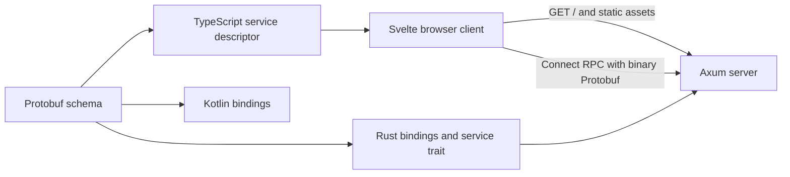

# Architecture

ArcDOS is a self-hosted file manager for a shared filesystem. Its first milestone implements a Svelte status page and a generated Connect RPC health endpoint in Axum. The Linux deployment target is a Docker host inside a Proxmox VM.

The Rust server serves both the static site and RPC from one origin. A browser calls the generated service from JavaScript after the page loads. The Kotlin output gives the future Android client the same protocol without adding an Android application to M1.

The M2 Linux file API uses the filesystem as the source of truth. A private SQLite WAL catalog maps relative locations to opaque IDs, records mutation intents, and assigns durable change sequence numbers. Connect handles structured operations. Separate HTTP routes stream uploads and downloads.

The M3 workspace at `/files/` loads paged file metadata, renders virtual list and grid views, and uses the HTTP routes for transfers and previews. Browser history stores the active collection and folder ID. The browser checks the server change journal while the page is visible.

M4 adds Authentik authorization code flow with PKCE and server-side browser sessions. The Axum file router checks current group access with Authentik before serving metadata, mutations, transfers, or content. The web uses a same-origin session cookie and CSRF token. An optional separate public client supplies bearer tokens for future Android integration. [Authentik setup](../deployment/authentik.md)

M5 extends the private SQLite catalog with observed revisions, file tags, durable index jobs, and an FTS5 keyword index. Filesystem notifications prioritize changed paths, while startup and periodic reconciliation discover missed changes. The indexer reads text through the confined filesystem root and search rechecks each hit's current revision before returning it. A separate vector crate stores versioned embeddings and can reconstruct an index for future semantic search. [Keyword search and indexing](../api/search-v1.md) · [Vector index evaluation](vector-index.md)

The AI worker will deploy independently and receive bounded inference and extraction jobs. Its availability must have no effect on authentication, file operations, basic search, or sync. Model output can propose file changes for user approval. The server owns validation, execution, and auditing.
