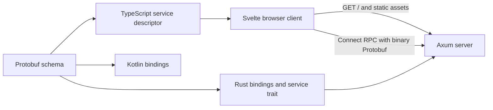

# Architecture

ArcDOS is a self-hosted file manager for a shared filesystem. Its first milestone implements a Svelte status page and a generated Connect RPC health endpoint in Axum. The Linux deployment target is a Docker host inside a Proxmox VM.

The Rust server serves both the static site and RPC from one origin. A browser calls the generated service from JavaScript after the page loads. The Kotlin output gives the future Android client the same protocol without adding an Android application to M1.

Later milestones give the Rust server exclusive responsibility for remote filesystem access, identity and authorization, metadata, transfers, and synchronization. The server will use the Linux filesystem as the source of truth. SQLite WAL and FTS5 will hold metadata, change history, and keyword indexes.

The AI worker will deploy independently and receive bounded inference and extraction jobs. Its availability must have no effect on authentication, file operations, basic search, or sync. Model output can propose file changes for user approval. The server owns validation, execution, and auditing.
