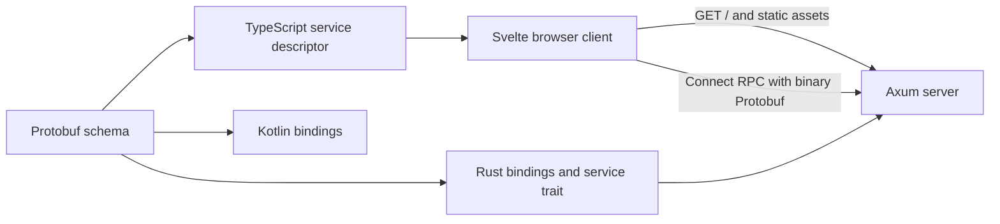

# Architecture

ArcDOS is a self-hosted file manager for a shared filesystem. Its first milestone implements a Svelte status page and a generated Connect RPC health endpoint in Axum. The Linux deployment target is a Docker host inside a Proxmox VM.

The Rust server serves both the static site and RPC from one origin. A browser calls the generated service from JavaScript after the page loads. The Kotlin output gives the future Android client the same protocol without adding an Android application to M1.

The M2 Linux file API uses the filesystem as the source of truth. A private SQLite WAL catalog maps relative locations to opaque IDs, records mutation intents, and assigns durable change sequence numbers. Connect handles structured operations. Separate HTTP routes stream uploads and downloads.

Later milestones add Authentik identity and authorization, indexed metadata and FTS5, and device synchronization.

The AI worker will deploy independently and receive bounded inference and extraction jobs. Its availability must have no effect on authentication, file operations, basic search, or sync. Model output can propose file changes for user approval. The server owns validation, execution, and auditing.
